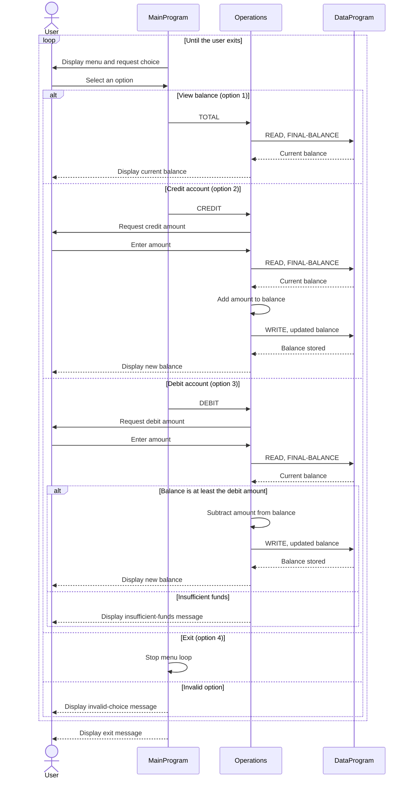

# COBOL Student Account Management

This directory documents the COBOL account-management example in `src/cobol/`. The program provides a console menu for viewing an account balance, crediting funds, and debiting funds. Although this example is described as a student account system, the code manages one account and does not store student identity or account records.

## Source Files

### `main.cob` - `MainProgram`

Runs the console interface and dispatches the user's selection to `Operations`.

- Option 1 requests the current balance (`TOTAL `).
- Option 2 starts a credit (`CREDIT`).
- Option 3 starts a debit (`DEBIT `).
- Option 4 exits the program; other selections display an error message.

### `operations.cob` - `Operations`

Implements the account actions and communicates with `DataProgram` to retrieve or update the balance.

- `TOTAL ` reads and displays the current balance.
- `CREDIT` accepts an amount, reads the balance, adds the amount, saves the new balance, and displays it.
- `DEBIT ` accepts an amount, reads the balance, and subtracts and saves the amount only when the balance is at least that amount. Otherwise it reports insufficient funds.

### `data.cob` - `DataProgram`

Owns the account balance in `STORAGE-BALANCE`, initialized to `1000.00`. Its linkage interface accepts an operation and a balance value:

- `READ` copies the stored balance to the caller.
- `WRITE` copies the caller's balance into storage.

The balance is held in working storage for the lifetime of the running program; it is not written to a file or database.

## Student Account Rules and Limitations

- The account starts with a balance of `1000.00` each time the program starts.
- Credits increase the balance by the entered amount.
- A debit is accepted only if the current balance is greater than or equal to the entered amount; an insufficient-funds debit leaves the balance unchanged.
- The amount and balance fields use `PIC 9(6)V99`, representing unsigned values with two implied decimal places and up to six integer digits.
- The program does not validate that a credit or debit amount is positive. In particular, a negative amount can reverse the expected effect of either operation. It also has no persistence, student identification, or separate-account support.

## Sequence Diagram

